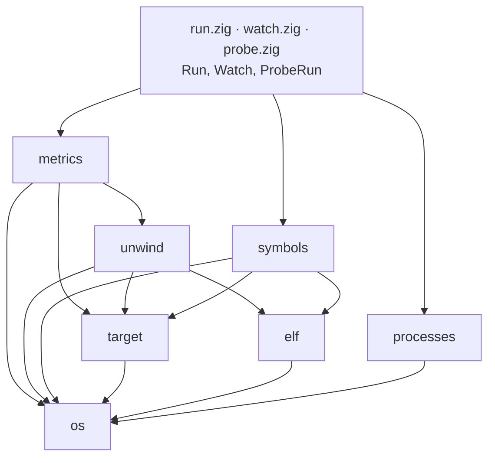
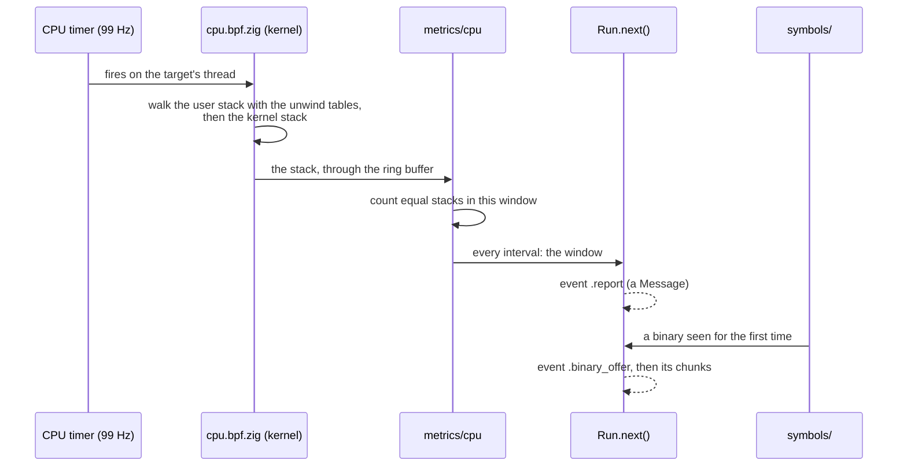

# agent

The agent is the part of nusku that sits next to a process and measures it. It samples
what the process runs on the CPU with eBPF, walks each sample's stack, and reports what it
saw once per interval. It also sends the server what it needs to put names on the
addresses: the binaries' symbols and the kernel's.

It does no naming and keeps nothing. Each report is raw addresses, and the server turns them
into function names (see [`server/`](../server/README.md)).

Needs root, or `CAP_BPF`, `CAP_PERFMON` and `CAP_SYSLOG`. `CAP_CHECKPOINT_RESTORE` lets it
read a program whose file was deleted or rebuilt while it runs. Function probes need
`CAP_SYS_ADMIN` as well.

## What it measures

| | |
|---|---|
| **On-CPU profile** (`Run`) | 99 samples a second on every CPU while the process runs; each sample is a whole stack, user and kernel |
| **The machine's processes** (`Watch`) | every process: CPU, memory, threads, user, command; the machine's CPU split (user, system, I/O wait, …) |
| **One function** (`ProbeRun`) | every call of a function: how many, and how long each took, as a histogram |

`protocol.Metric` names more (`offcpu`, `mem`, `io`, …), but only `cpu` exists so far; the
others are refused with `MetricNotImplemented`.

## Public API

Everything is in `root.zig`. Each of the three is used the same way, pull style: `init`, then
`next()` until it returns `null`, and `stop()` from anywhere to end it early.

```zig
const agent = @import("agent");

var run = try agent.Run.init(gpa, .{ .pid = pid, .interval_ms = 1000, .duration_s = 0 });
defer run.deinit();

while (try run.next()) |event| switch (event) {
    .report => |message| keep(message),           // one window: stacks, regions, counts
    .binary_offer => |offer| run.binary_want(want(offer)),
    .binary_begin, .binary_chunk, .binary_end, .binary_abort => send(event),
    .stopped => |reason| log(reason),               // duration, target_exited, cancelled
};
```

| Type | Options | Events |
|---|---|---|
| `Run` | `pid` or `program`, `metrics`, `interval_ms`, `duration_s`, `binaries` | `RunEvent`: `report`, `binary_*`, `stopped` |
| `Watch` | `interval_ms`, `duration_s` | `WatchEvent`: `frame`, `stopped` |
| `ProbeRun` | `pid`, `function`, `module`, `interval_ms`, `duration_s` | `ProbeEvent`: `attached`, `report`, `stopped` |

The events and the messages in them are types from `shared/protocol`, so the agent and the
server agree on them without importing each other.

Rules for callers:

- An event points into the agent's memory. It is valid only until the next `next()`, so copy
  what you keep.
- `stop()` is safe from any thread and from a signal handler. The run then ends with
  `stopped: .cancelled`.
- An offered binary must be answered before the run goes on:
  - `binary_want(true)` to have it sent;
  - `binary_want(false)` when the server has it;
  - `binary_later()` when the server is busy.
- `binaries_resend()` offers again every binary that was sampled, for a server that lost one.
- The agent never stops or kills a process it attached to by pid. It only watches it.
- Given a `program` (`argv`, `keep_running`) instead of a pid, a run starts it itself, held
  before its first instruction, and lets it run once everything is attached, so nothing of it
  is missed. `run.pid` is then its pid. When the run stops, the program is ended (`SIGCONT`,
  `SIGTERM`) unless it was kept running or exited first. The process the agent runs in is its
  parent and must reap it: `program_reaped(pid)` does, once it has ended.

`testing/examples/server_feed.zig` is a whole, working use of `Run` on its own thread.


## Architecture



Each layer is a folder with one facade file, `name/name.zig`, which is all the layers above it
may import. A layer imports only layers below it, never one beside it; the parent files at the
root (`run.zig`, `watch.zig`, `probe.zig`) put them together.

| Layer | What it gives |
|---|---|
| `os/` | the system calls the rest stands on: timers, `poll`, pidfd, perf events, cancel, CPU lists, and launching a program held stopped, holding none of the profiler's files |
| `elf/` | reading ELF files and their `.eh_frame` |
| `target/` | the process being profiled: its executable regions, each file behind them, build IDs, the vDSO, the kernel's identity |
| `unwind/` | the unwind tables the BPF program walks stacks with: DWARF CFI rows from `.eh_frame`, and Go's `pclntab`, which even stripped Go binaries keep |
| `metrics/` | what is measured: the BPF programs, their loader, perf events on every CPU, the ring buffer, and one window of samples at a time |
| `symbols/` | what the server needs to name addresses: each binary's symbol and DWARF sections; for a stripped one, those of its debug file under `/usr/lib/debug/.build-id/`, sent as they are, never parsed or decompressed; the vDSO's; the kernel's from `/proc/kallsyms` |
| `processes/` | `/proc` read into one frame of every process and the machine's CPU, and one process's name and command line |

### How a sample becomes a stack



1. A CPU-clock perf event fires 99 times a second on every CPU and runs
   `metrics/kernel/cpu.bpf.zig`.
2. If the CPU is running the target, the program walks the user stack in the kernel:
   - It finds each frame's caller from the unwind tables `unwind/` put in BPF maps.
   - It falls back to frame pointers where a binary has no table.
   - It follows Go's switch to its system stack back to the goroutine.
3. The kernel stack comes from the kernel's own stack walker.
4. The stack goes through a ring buffer to `metrics/cpu`. Equal stacks are counted together
   into one window, and every interval the window becomes a `Message`.
5. Meanwhile, `symbols/` offers each binary that appeared in a stack. The kernel's symbols are
   read once and kept in `~/.cache/nusku`, so later runs skip the second it costs to read
   `/proc/kallsyms`.

The BPF programs are written in Zig and compiled to `bpfel` by `build.zig`. The loader
(`metrics/bpf`) takes one function per section, with no `.text` subprograms and no read-only
data, so helpers there are `inline`.

A stack the walk could not finish is still reported, marked `complete = false`, so a profile
can say how much it could not see instead of hiding it.

## Tests

```sh
zig build test                    # from the repository's root; the tests that need root skip
sudo zig build test -Dapp=false   # all of them
```

`testing/e2e/` profiles real programs end to end, including the vDSO, CPUs going on and
offline, and Go programs (built by the test with `go`). `testing/process.zig` spawns the
children they profile.
